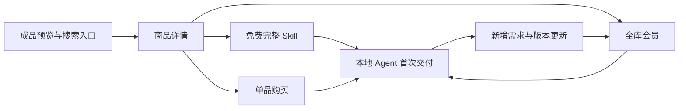

# Skillry 商业模式研究

核验日期：2026-10-20。范围：官方首页、付费与免费商品样本、安装指南、服务条款、推广联盟、第三方声明，以及 WebToMind 本地实现。本文的价格是页面展示价格，未进入实际付款；没有购买、下载付费包或验证其履约。

对应执行方案：[WebToMind 会员权益与 Skill 销售策略](SKILL_MEMBERSHIP_AND_SALES_STRATEGY.md)。

## 1. 关键判断

Skillry 的商业结构是 **免费完整体验 + 单品购买 + 全库订阅 + 创始终身访问**。月付和年付是同一权益的不同周期。我们原先只对齐订阅价格，遗漏了单品购买入口和商品详情页的成本、适用边界说明。

值得参考的是：用可见的成品降低购买不确定性，再用明确的安装与依赖说明帮助用户复现。WebToMind 应集中制作创作者、小商家和产品发布工作流，先把少量商品的完整交付做扎实。

以下“判断”“建议”均为本次分析，不是竞品披露的经营数据或已验证的 WebToMind 转化结果。

## 2. 一手证据与影响

| 来源 | 本次核实的信息 | 对 WebToMind 的影响 |
| --- | --- | --- |
| [首页与套餐](https://skillry.dev/) | 月付 $9.99、年付 $79、Founding Lifetime $169；会员包含当前与新增 Premium、更新、安装访问 | 价格可作锚点；权益必须定义内容范围、有效期、算力边界 |
| [服务条款](https://skillry.dev/terms)，页面日期 2026-10-17 | 支持单品授权；取消后保留本期访问；终身依赖服务持续运营；每日最多下载 50 个不同 Skill；原则不退款但保留法定例外 | 不把“终身”写成永久运营保证；取消、下载、退款规则需要前后台一致 |
| [付费视频样本](https://skillry.dev/skills/bs-linear-agent-style-launch-video) | v1.0.1，展示 $4.99 Buy now，同时推荐全库订阅；列出输入、HTML/MP4 输出、依赖和额外音乐成本 | 单品是低门槛入口；会员是重复需求的升级入口 |
| [免费网页样本](https://skillry.dev/skills/bs-mint-noir-saas-site) | 免费五页网站模板与校验工具；明确没有支付、登录等真实后端 | 免费商品也要完整可用，且明确交互演示与真实服务的区别 |
| [图片样本](https://skillry.dev/skills/bs-openai-style-og) | 页面列出 GPT Image、FAL、Node 依赖与另付生成成本；列出已测试版本/Agent | 每个商品独立说明兼容与费用，不能把某个 Agent 的结果推广为全平台保证 |
| [安装指南](https://skillry.dev/learn/agents/claude-code) | 安装提示词、CLI、ZIP 三条路径；说明目标 Agent 目录与安装后的确认方式 | 从“复制命令”推进到“Agent 找得到、能运行、能产出” |
| [联盟计划](https://skillry.dev/affiliate) | 推荐客户首次购买起 12 个月内的合资格付款佣金为 40%，包含期间续费；人工结算 | 可以参考演示内容带货，但不能直接照搬佣金；先核算本项目贡献毛利 |
| [第三方声明](https://skillry.dev/third-party-notices) | 公示组件、字体等许可来源 | 我们的自有增量、开源依赖、示例素材要分别列权利与来源 |

首页自称 400+ Skills、展示用户与社交证明；本次未独立核对数量、活跃用户或收入，不能用于推算我们的市场规模。用户截图中的“Most popular”也不构成销量证明。

## 3. 商品页比套餐页更值得参考

### 付费视频：销售的是可改造的交付流程

Linear Agent Style Launch Video 页面同时展示单品价、订阅入口和预览；交付物包含可编辑 HTML 与 MP4，标注不适合口播，也明确界面是基于产品资料重建的 HTML，不是实时录屏。依赖与外部音乐费用单列。上述内容是卖方页面说明，未实跑验证。

**应用：** WebToMind 的六条宣传片统一为英文、16:9、无口播；必须区分 Skill 原始输出与后期宣传包装。用 huashu-motion 添加的镜头、配乐、字幕或场景编排，不应被默认算作该商品自身能力。

### 免费网页：免费也能完成一项工作

Mint Noir 样本把一个五页网站作为完整免费体验，并明确前端示例没有后端。免费价值与边界同时呈现。

**应用：** 免费五项保留完整导出；付费价值来自多页、多素材、一致性控制和交付质量，而不是给免费成品打水印或故意缺最后一步。

### 图片工作流：内容授权不包含生成账单

OpenAI Style OG 样本把输出、输入资料、运行依赖与外部费用分开列示。

**应用：** 我们可优先支持 Codex 内置生图，备用提供其他明确测试过的路线。必须标注所需账号/套餐与费用承担方；不能把用户宿主中的生图能力承诺为 WebToMind 会员赠送的无限算力。

## 4. 访问与许可证是两层

Skillry 条款允许商业工作用途，限制付费包、下载链接及凭证转售或再分发，并保留第三方条款约束。条款明确订阅有效期内访问，但本次没有找到足够明确的“订阅到期后，已下载包继续使用许可”说明；不要替它补充结论。

**我们需要明确约定：** 已合法获得版本的继续使用、到期后的重新下载与更新、新内容获取、客户成品交付、原始 Skill 转售、多人席位、退款撤销分别如何处理。不能用一个“商用”标签替代这些边界。

## 5. 销售路径推断

根据以上可见入口，可以推断其路径是：

这是对产品界面的解释，不是后台漏斗数据。我们应衡量首次成功产出和重复需求，而不只看下载量。

## 6. WebToMind 现状：本地源码核验

| 本地依据 | 当前行为 / 问题 |
| --- | --- |
| `src/web/pages/skill-catalog/SkillPricingSection.tsx` | 显示 $9.99/$79/$169 与 ¥49/¥399/¥899；Pro 文案附带创作台积分；Lifetime 文案承诺 forever；英文 Popular 没有本次可验证的销量依据 |
| `supabase/migrations/20261018090000_skill_catalog_subscription.sql` | 新套餐默认 inactive；`skill_pro` 复制旧 Pro 积分和限制；lifetime 不含月度积分；旧 Pro/Max 包含 Premium |
| `src/shared/pricing-catalog.ts` | 旧 Pro 本地回退价 $20/月、$168/年，10,000 积分/月。新 Skill Pro 若按 $9.99/$79 给同等积分，会造成低价替代和算力成本压力；这不是线上成交价核验 |
| `api/membership/checkout.ts` | 订单入口包含订阅、积分、API 积分、Skill Lifetime；没有完整单品/套装订单类型 |
| `api/skill-catalog/service.ts` 与迁移 | 已有 `single_purchase` 权益来源；不等于单品购买、退款和重下载闭环已完成 |
| `api/agent/skill-run.ts` | 网页 Skill runtime 禁用，不能卖“网页一键运行全部 Skill” |
| `src/web/pages/TermsPage.tsx` | 仍使用旧服务类型说明与通用知识产权段落；未建立完整 Skill 授权合同结构 |
| 内容仓库 `docs/STATUS.md` | 30 个包均 review；7 个登记案例，其中 6 个历史独立 Agent 案例、1 个当前会话案例；23 个缺登记案例 |
| `skills/xhs-carousel/skill.json` | 当前仍声明 `zh-CN` / `cn`；英文宣传片存在不等于英文商品支持已经完成验收 |

本次未查询生产数据库、未修改支付产品、未执行迁移或部署。因此上述内容不能推断线上当前套餐、用户权益或销售状态。

## 7. 调研范围与未核实项

- 已读取官方页面与本地源文件；未登录购买、未实际付费、未安装竞品付费包、未验证退款执行。
- 个别页面与 `install/agent.md` 直接抓取超时/失败，改用成功返回的官方安装指南和免费网页样本；不将失败当作页面不存在。
- Chrome 桥未连接，未完成真实浏览器的结账弹窗与登录状态检查；公开展示价格不代表税后实付。
- 页面宣称的兼容性、用户数、评分与产出能力按卖方陈述处理。
- 没有复制竞品付费包、视觉素材、文案或品牌资产到本项目。本文仅保存必要的事实摘要和链接。
